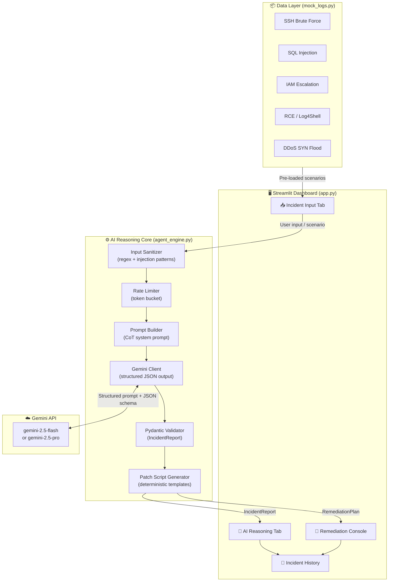
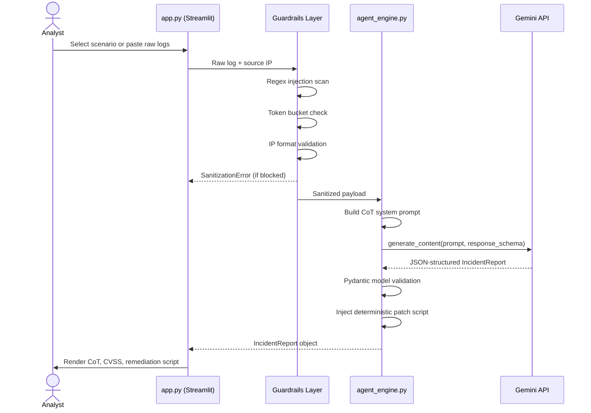
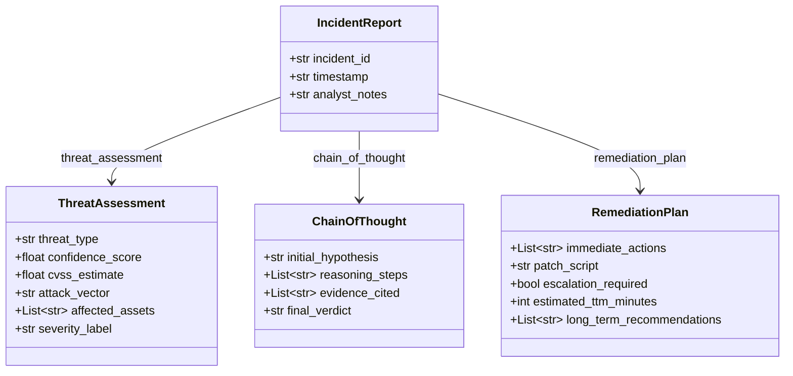
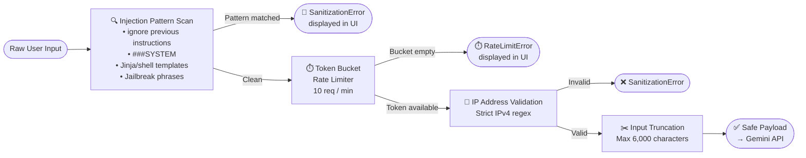

# 🛡️ SentinelAI — Autonomous Cybersecurity Incident Triage & Remediation

[](https://python.org)
[](https://streamlit.io)
[](https://ai.google.dev)
[](LICENSE)

SentinelAI is an autonomous AI agentic system for **real-time cybersecurity incident triage and remediation**. It integrates a Gemini-powered Chain-of-Thought reasoning pipeline with a Streamlit security dashboard to classify threats, score severity, explain AI reasoning, and generate executable remediation scripts — all within a secure, guardrail-hardened architecture.

---

## ✨ Features

| Feature | Detail |
|---|---|
| **5 Realistic Incident Scenarios** | SSH Brute Force, SQL Injection, IAM Privilege Escalation, RCE/Log4Shell, DDoS SYN Flood |
| **Structured AI Reasoning** | Gemini 2.5 with JSON schema enforcement, CVSS scoring, and step-by-step Chain-of-Thought |
| **Prompt Injection Guardrails** | Regex-based injection pattern detection, input truncation, IP validation |
| **Rate Limiting** | Token-bucket mock limiter (10 req/min) with live UI badge |
| **Remediation Scripts** | Deterministic bash scripts, FOR REVIEW ONLY, per threat type |
| **Incident History** | Session-scoped DataFrame with CSV export |
| **Dark Security UI** | Custom Streamlit dark theme with severity badges, CoT cards, escalation alerts |

---

## 🏗️ System Architecture



---

## 🔄 Data Flow — Sequence Diagram



---

## 📐 Pydantic Model Hierarchy



---

## 🔒 Security Guardrails Architecture



---

## 📁 Project Structure

```
sentinel-ai-agent/
├── app.py              # Streamlit dashboard (UI, tabs, session state)
├── agent_engine.py     # Gemini AI pipeline, Pydantic models, guardrails
├── mock_logs.py        # 5 realistic incident datasets
├── requirements.txt    # Python dependencies
├── .env                # API keys (not committed — see setup)
├── .env.example        # Template for environment variables
└── README.md           # This file
```

---

## 🚀 Setup & Installation

### Prerequisites

- Python 3.11+
- A [Google Generative AI API key](https://aistudio.google.com/app/apikey)

### 1. Clone the repository

```bash
git clone https://github.com/yourorg/sentinel-ai-agent.git
cd sentinel-ai-agent
```

### 2. Create a virtual environment

```bash
python -m venv .venv

# Windows
.venv\Scripts\activate

# macOS / Linux
source .venv/bin/activate
```

### 3. Install dependencies

```bash
pip install -r requirements.txt
```

### 4. Configure environment variables

```bash
# Copy the template
cp .env.example .env
```

Edit `.env`:

```env
GOOGLE_API_KEY=AIzaSy...your_key_here
```

> **Tip:** You can also enter the key directly in the Streamlit sidebar at runtime. The `.env` file pre-fills it for convenience.

### 5. Run the dashboard

```bash
streamlit run app.py
```

Open [http://localhost:8501](http://localhost:8501) in your browser.

---

## 🎮 Usage Guide

### Using Mock Scenarios

1. Open the **Incident Input** tab.
2. Select `📦 Load Mock Scenario`.
3. Choose from the 5 pre-loaded incident types.
4. Click **⚡ Analyze with SentinelAI**.
5. Switch to **AI Reasoning** to see CoT steps and CVSS score.
6. Switch to **Remediation Console** to review the bash script.

### Using Custom Logs

1. Select `📝 Paste Raw Logs`.
2. Enter the attacker IP, event type, and severity.
3. Paste your raw log content.
4. Click **⚡ Analyze with SentinelAI**.

### Exporting History

- Navigate to **Incident History**.
- Click **📥 Export to CSV** to download the session log.

---

## 📊 Example AI Output

The Gemini API returns a structured JSON object conforming to this schema:

```json
{
  "incident_id": "INC-20261023-A1B2C3D4",
  "timestamp": "2026-10-23T07:30:00Z",
  "analyst_notes": "A sophisticated SQL injection attack was detected against the user search API...",
  "threat_assessment": {
    "threat_type": "SQL Injection (Time-Based Blind / UNION-Based)",
    "confidence_score": 0.97,
    "cvss_estimate": 9.1,
    "attack_vector": "Network",
    "affected_assets": ["api-gateway-prod (10.0.2.15)", "PostgreSQL users_db"],
    "severity_label": "CRITICAL"
  },
  "chain_of_thought": {
    "initial_hypothesis": "The User-Agent string 'sqlmap/1.7.8' immediately indicates automated SQLi tooling.",
    "reasoning_steps": [
      "Identified 'sqlmap' in User-Agent header — confirms use of automated SQLi framework.",
      "Log line shows 1' OR '1'='1 — classic boolean-based blind injection payload.",
      "UNION SELECT null,null,null -- pattern indicates column enumeration attempt.",
      "pg_sleep(5) call with subsequent 5031ms timeout confirms time-based blind SQLi success.",
      "information_schema.tables reference suggests schema exfiltration in progress."
    ],
    "evidence_cited": [
      "User-Agent: sqlmap/1.7.8#stable",
      "query=SELECT * FROM users WHERE id=1;UNION SELECT null,null,null--",
      "Request timeout after 5031ms (pg_sleep confirmed)",
      "information_schema.tables referenced in query"
    ],
    "final_verdict": "Confirmed active SQL injection attack using sqlmap. Time-based blind and UNION techniques observed. Schema enumeration likely succeeded. Immediate containment and credential rotation required."
  },
  "remediation_plan": {
    "immediate_actions": [
      "Block source IP 203.0.113.88 at WAF and network firewall immediately.",
      "Set WAF to blocking mode (SecRuleEngine On).",
      "Revoke and rotate PostgreSQL credentials for the api_user role.",
      "Audit pg_log for any rows returned by UNION queries to assess data exposure.",
      "Enable query parameterisation / prepared statements in the application layer."
    ],
    "patch_script": "#!/usr/bin/env bash\n# ⚠️  FOR REVIEW ONLY...",
    "escalation_required": true,
    "estimated_ttm_minutes": 45,
    "long_term_recommendations": [
      "Implement parameterised queries / ORM across all database interactions.",
      "Deploy a WAF with OWASP CRS rule set in blocking mode.",
      "Run quarterly DAST scans (OWASP ZAP, Burp Suite Pro).",
      "Enable pg_audit extension for comprehensive query logging.",
      "Adopt a least-privilege DB role model — no direct schema access for API users."
    ]
  }
}
```

---

## 🔐 Security Disclosure & Responsible Use

### Guardrails Implemented

| Layer | Mechanism | Protection |
|---|---|---|
| **Prompt Injection** | Regex pattern matching on 9 known patterns | Prevents adversarial log payloads from hijacking AI instructions |
| **Input Validation** | Strict IPv4 regex, max 45-char IP, max 6,000-char log | Prevents oversized or malformed inputs |
| **Rate Limiting** | Token-bucket (10 req/min, session-scoped) | Prevents API abuse and cost runaway |
| **Output Validation** | Pydantic v2 model validation on all AI responses | Ensures type-safe, schema-conformant outputs |
| **Script Safety** | All scripts marked `FOR REVIEW ONLY`, no auto-execution | Prevents accidental destructive commands |
| **AI Temperature** | Gemini `temperature=0.2` | Reduces hallucinations in security-critical output |

### Limitations & Warnings

> **⚠️ This system is a decision-support tool, not an autonomous remediation engine.**

- Remediation scripts **must be reviewed by a qualified analyst** before execution.
- CVSS scores are **AI estimates**, not official NVD assessments.
- The system **does not replace** a full SIEM, EDR, or SOC workflow.
- Do **not submit logs containing real PII**, credentials, or classified data to the Gemini API.
- Rate limits are **session-scoped mock limits** — production deployments should implement server-side rate limiting.

### Threat Model

- **In scope:** Automated log analysis, threat classification, reasoning explanation, remediation guidance.
- **Out of scope:** Autonomous script execution, live system access, real-time log streaming integration.

---

## 🛠️ Environment Variables Reference

| Variable | Required | Default | Description |
|---|---|---|---|
| `GOOGLE_API_KEY` | Yes | — | Google Generative AI API key |

---

## 🤝 Contributing

1. Fork the repository.
2. Create a feature branch: `git checkout -b feature/my-feature`.
3. Commit your changes: `git commit -m 'feat: add my feature'`.
4. Push: `git push origin feature/my-feature`.
5. Open a Pull Request.

Please follow [Conventional Commits](https://www.conventionalcommits.org/) and ensure all new scenarios include a corresponding mock log dataset.

---

## 📜 License

MIT License — see [LICENSE](LICENSE) for details.

---

*Built with ❤️ and 🛡️ by the SentinelAI team.*
